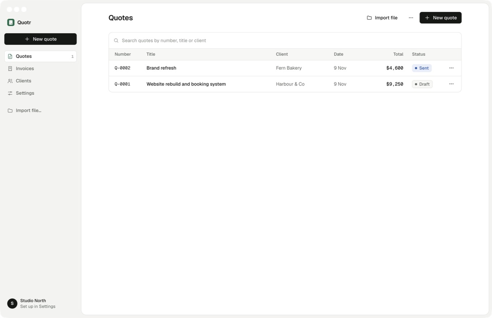
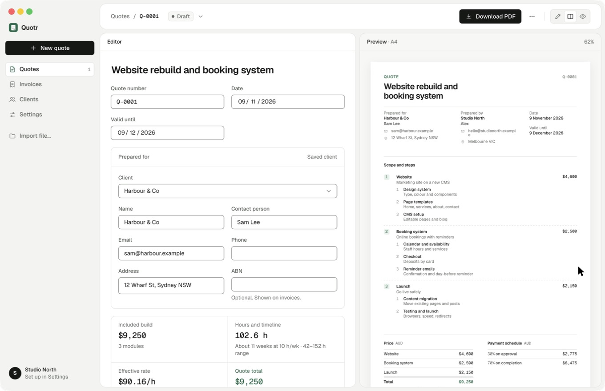

# Quotr

A macOS app for building quotes and invoices and saving them as clean A4 PDFs. Everything saves automatically on your Mac, with no account and no server.





## Features

- **Quotes** made of priced modules and steps, with a live A4 preview.
- **Estimates from hours:** best, likely and worst case plus a risk buffer, turned into a price at your rate. Hours never appear on the quote.
- **Invoices** created from a quote, one per payment stage or for the full amount.
- **PDF export** to a folder you choose, using Google Chrome in the background.
- **Auto-save** of quotes, invoices, clients and settings as JSON files in `~/Library/Application Support/com.neohaggard.quotr/`.
- **`.quotr` files** to import (⌘O, or drag one onto the window) and export. Full backups are under Settings → Backup.

## Run it

Needs macOS, [Bun](https://bun.sh) and Google Chrome.

```bash
bun install
bun run dev
```

| Script | What it does |
| --- | --- |
| `bun run dev` | Builds and opens the app. |
| `bun run hmr` | Hot-reload server; run it next to `dev`. |
| `bun run build` | Release build, with a DMG in `artifacts/`. |
| `bun run typecheck` | Runs TypeScript. |

## How it's built

- React and Tailwind v4 UI in a native WebKit window, built with [Electrobun](https://docs.electrobun.dev/electrobun/).
- A small Bun main process (`src/bun/`) saves files, opens dialogs and makes PDFs. It talks to the UI over typed RPC (`src/shared/rpc.ts`).

[docs/desktop-plan.md](docs/desktop-plan.md) explains the design decisions.
